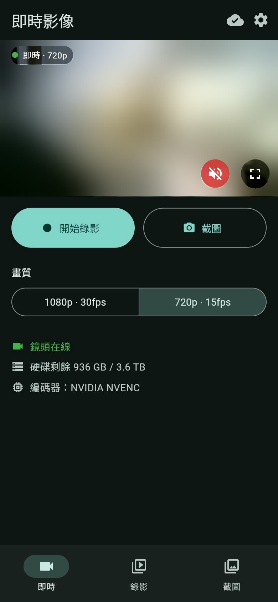
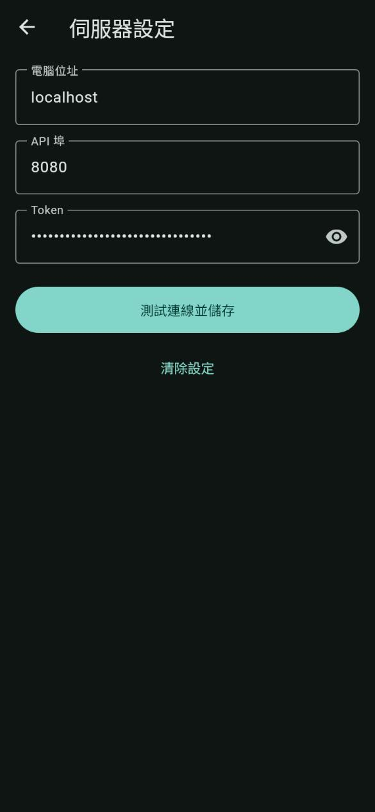
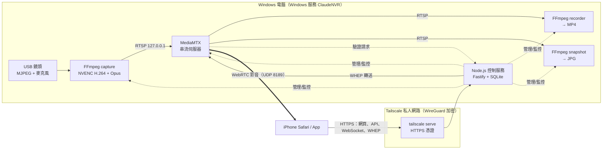

# Claude NVR — 個人監控系統

用一台 Windows 電腦和一支 USB 鏡頭，做成可以在外面用手機看的監控系統。
即時畫面（含聲音）、手動錄影、截圖、回放；只有自己的裝置連得進來。

<p align="center">
  
  &nbsp;&nbsp;
  
</p>
<p align="center"><sub>左：即時畫面（截圖已將鏡頭畫面模糊處理）　右：伺服器設定</sub></p>

## 功能

- **即時畫面**：WebRTC 低延遲，含聲音，可靜音、全螢幕，斷線自動重連
- **畫質切換**：`1080p · 30fps`（4 Mbps）或 `720p · 15fps`（1.2 Mbps），使用 NVIDIA NVENC 硬體編碼
- **手動錄影**：MP4（H.264 + AAC），每 30 分鐘自動分檔，斷電也救得回來
- **截圖**：一鍵擷取當下畫面（約 1 秒）
- **回放**：錄影列表與播放器、截圖格狀瀏覽（可縮放）
- **外出觀看**：透過 Tailscale 私人網路，不需要開路由器的 Port，也不暴露在網際網路上
- **跨平台**：同一份 Flutter 程式碼，iPhone 用 Safari 網頁版（可加入主畫面），Android 可編成 APK

## 介面介紹

App 下方有三個分頁，右上角是連線狀態和設定。

### 即時

| 區塊 | 說明 |
|---|---|
| 畫面左上角標籤 | 連線狀態（綠點＝播放中）與目前畫質 |
| 畫面右下角按鈕 | 🔇 靜音（紅色＝已靜音，切換分頁後仍會記住）、⛶ 全螢幕（橫向） |
| 開始錄影 / 停止錄影 | 錄影中畫面上會出現 `REC 00:00` 計時，標題列也會亮紅點（切到其他分頁也看得到） |
| 截圖 | 完成後跳出提示，可以直接點「查看」 |
| 畫質 | 切換 1080p / 720p，畫面會中斷約 2 秒後自動重連 |
| 狀態列 | 鏡頭是否在線、硬碟剩餘空間、編碼器 |

> iPhone Safari 會擋住自動播放的聲音，進入即時畫面後**點一下畫面**才會出聲。

### 錄影

依時間由新到舊列出所有錄影，顯示縮圖、日期、長度、畫質和檔案大小；往下捲動會自動載入更多。
點一下進入播放器（可拖拉進度），每一筆右邊的垃圾桶可以刪除（會先確認）。

### 截圖

格狀顯示所有截圖，點開可以雙指縮放，右上角可以刪除（會先確認）。

### 設定（右上角齒輪）

輸入電腦位址和 token。iPhone 從 HTTPS 網址開啟時，位址會自動帶入，只要貼上 token。
右上角的雲朵圖示代表即時事件連線（WebSocket）是否正常。

## 系統架構



### 元件

| 元件 | 技術 | 職責 |
|---|---|---|
| 擷取 | FFmpeg（DirectShow → NVENC H.264 / Opus） | 讀 USB 鏡頭與麥克風，編碼後推到 MediaMTX。用電腦時鐘標時間戳，修正鏡頭實際幀率不穩造成的延遲累積和音畫不同步 |
| 串流 | [MediaMTX](https://github.com/bluenviron/mediamtx) | 一路輸入、多路輸出：WebRTC 給手機，RTSP 給錄影與截圖。驗證交給 Node 服務 |
| 控制服務 | Node.js 20 + TypeScript、Fastify 5、better-sqlite3、pino | 啟動並監控所有子程序（掛掉自動重啟）、REST API、WebSocket 即時事件、錄影/截圖索引、提供網頁版、轉送 WHEP |
| 錄影 | FFmpeg | 先寫 fragmented MP4（斷電可救），停止後轉成 faststart MP4（AAC 音訊，手機可直接播放）並產生縮圖 |
| App | Flutter 3（Dart）、Riverpod、flutter_webrtc、dio、video_player | 一份程式碼：網頁版（iPhone）、Android；之後有 Mac 也能編 iOS 原生 App |
| 遠端連線 | Tailscale + `tailscale serve` | 私人網路與 HTTPS 憑證，不需要開 Port 或固定 IP |
| 部署 | NSSM（Windows 服務）、Windows 防火牆 | 開機自動啟動、當機自動重啟、log 自動輪替 |

### 資料流程

- **即時畫面**：App 透過 HTTPS 送出 WebRTC offer 到 `/api/live/whep`。Node 驗證 token 後轉給 MediaMTX，影音資料則經 Tailscale 由 MediaMTX 直接送到手機。
- **錄影**：按下錄影後，Node 啟動 FFmpeg 從 MediaMTX 讀 RTSP 寫檔。停止時整理成 MP4、產生縮圖、寫入 SQLite，並用 WebSocket 通知 App。
- **截圖**：Node 用 FFmpeg 從 RTSP 抓一張畫面，產生原圖和縮圖。
- **狀態同步**：App 開一條 WebSocket，接收鏡頭上下線、錄影開始/停止/完成、截圖完成等事件。

## 資安設計

| 層級 | 做法 |
|---|---|
| 網路 | 只有登入同一個 Tailscale 帳號的裝置連得到（WireGuard 加密）；伺服器另有 IP 白名單，防火牆規則也只對 Tailscale 網段開放 |
| 傳輸 | `tailscale serve` 提供有效的 HTTPS 憑證；RTSP 與 MediaMTX API 只綁定 `127.0.0.1` |
| 驗證 | 所有 API 都要 `Authorization: Bearer <token>`，使用 timing-safe 比對 |
| 媒體網址 | 圖片、影片、WebSocket 用 HMAC-SHA256 簽章網址（綁定路徑、只限 GET、有效期限），**token 永遠不出現在網址裡** |
| 即時串流 | MediaMTX 把每次讀取/推流都交給 Node 驗證：本機程序可推流，遠端只能讀取 `cam`，而且必須帶 token |
| 暴力破解 | 同一 IP 10 分鐘內失敗 10 次，封鎖 15 分鐘 |
| 代理 | 只信任來自本機（`tailscale serve`）的 `X-Forwarded-For`，外部無法偽造來源 IP |
| 其他 | 不開 CORS（同源）、5xx 不洩漏內部訊息、安全回應標頭、Android 關閉備份、App 用 secure storage 存 token |

## 目錄結構

```
├─ server/          Node.js 控制服務（詳見 server/README.md）
│  ├─ src/          api.ts、stream/（擷取、MediaMTX）、media/（錄影、截圖）、security.ts …
│  └─ config.example.json
├─ app/             Flutter App（詳見 app/README.md）
├─ mediamtx/        mediamtx.yml（執行檔請另外下載）
├─ scripts/
│  ├─ install-service.ps1   安裝成 Windows 服務（NSSM）
│  ├─ setup-firewall.ps1    防火牆規則（只允許 Tailscale）
│  └─ set-config.mjs        修改 config.json（不會顯示 token）
├─ docs/            README 用的截圖
└─ storage/         錄影、截圖、資料庫、log（執行時產生，不進版控）
```

## 安裝與部署

需求：Windows 10/11、NVIDIA 顯示卡（驅動需支援所用 FFmpeg 的 NVENC 版本；沒有的話把 `camera.encoder` 改成 `x264`）、USB 鏡頭。

1. **安裝工具**：Node.js 20、[FFmpeg](https://www.gyan.dev/ffmpeg/builds/)（加入 PATH）、Flutter SDK（只有要編 App 時才需要）
2. **下載 MediaMTX**：把 [Windows 版](https://github.com/bluenviron/mediamtx/releases) 的 `mediamtx.exe` 放到 `mediamtx/`
3. **伺服器**
   ```bash
   cd server
   npm install
   npm start          # 第一次啟動會產生 config.json 和隨機 token
   ```
   用 `ffmpeg -list_devices true -f dshow -i dummy` 查出鏡頭和麥克風名稱，填進 `config.json` 的 `camera.video` / `camera.audio`
4. **網頁版**
   ```bash
   cd app
   flutter build web --release --no-web-resources-cdn
   ```
5. **安裝成 Windows 服務**（系統管理員 PowerShell）
   ```bash
   scripts\install-service.ps1
   ```
6. **Tailscale**：電腦和手機都安裝並登入同一個帳號，在電腦上啟用 HTTPS：
   ```bash
   tailscale serve --bg http://127.0.0.1:8080
   ```
7. **防火牆**（系統管理員 PowerShell）
   ```bash
   scripts\setup-firewall.ps1 -TailscaleOnly
   ```
8. **手機**：Safari 開 `https://<電腦名稱>.<tailnet>.ts.net`，貼上 `server/config.json` 裡的 token，再「加入主畫面」

## 已知限制與規劃

- iPhone 目前使用網頁版。要做 iOS 原生 App 需要 Mac + Xcode，程式碼已經支援
- 錄影只有手動模式。規劃中：動態偵測自動錄影、推播通知（事件匯流排已預留 `motion.*`）
- Android APK 目前用 debug 金鑰簽署，正式散布前要換成自己的 release keystore
- 設計給單一使用者，沒有多帳號與權限管理
